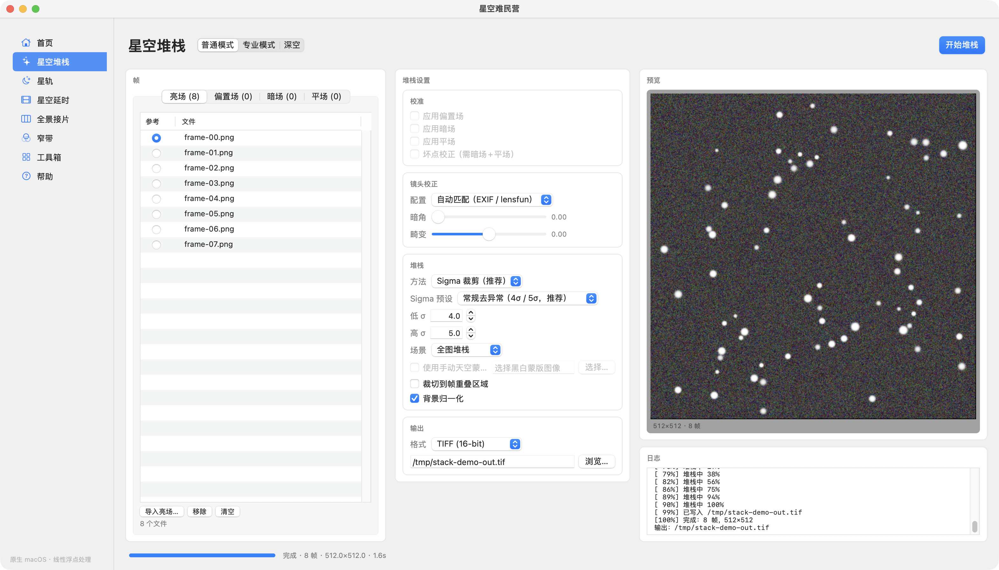

# Starry Haven · 星空难民营

[](https://github.com/Kuokuojing/starryHaven/actions/workflows/ci.yml)


一个原生 macOS 天文摄影处理工具。界面使用 AppKit，处理核心使用 Swift，覆盖星空堆栈、星轨、星空延时、全景接片、窄带合成和常用后期工具。



## 功能

### 星空堆栈

- 普通 / 专业 / 深空三档预设。
- 亮场、偏置场、暗场、平场分组导入，亮场参考帧单选。
- 主帧校准、坏点校正、背景归一化、裁切到重叠区域。
- Sigma 裁剪、均值、中值、最大值、最小值堆栈；Sigma 提供 2σ/3σ、4σ/5σ、6σ/6σ 三档预设。
- 全图堆栈、天地分离堆栈，支持 SkySeg 自动蒙版或手动黑白蒙版。
- TIFF 16-bit、FITS 32-bit float、PNG、JPEG 输出。

### 星轨 / 星空延时 / 全景接片 / 窄带

- **星轨**：最大值、均值、中值、最小值合成；固定 / 动态地景；基于 Hough 直线检测的飞机、卫星轨迹剔除；辉光。
- **星空延时**：曝光去闪（15 / 31 帧窗口）、H.264 MP4 导出、关键帧导出。
- **全景接片**：星点配准、自动画布、羽化融合。
- **窄带**：Ha / OIII / SII 合成，SHO、HOO、HSO 调色，联动拉伸，可选 StarNet2 去星。

### 工具箱

| 工具 | 说明 |
| --- | --- |
| 星点分离｜合成 | StarNet2 CoreML 分块推理，输出星点层与去星层 |
| 降噪 | DeepSNR CoreML 分块推理 |
| 天地分离 | SkySeg ONNX 或手动蒙版，天空限定处理 |
| 白平衡校正 | 自动灰世界或色温 / 色调 |
| 缩星｜星柔 | 高通星点抑制与柔化 |
| 图像增强 | 局部对比、结构增强、天光压制、星轨辉光 |

### 首页与帮助

- 首页是内置说明页，包含项目介绍、联系方式和鸣谢。
- 帮助页提供 9 个快捷导航入口，覆盖所有工作区、镜头配置、项目文件和快捷键，并内嵌界面截图。

## 系统要求

- macOS 14 或更新版本。
- Apple Silicon（CoreML 推理按 ARM64 优化）。
- Swift 6 工具链。只装 Command Line Tools 也能构建；不需要完整 Xcode。
- 可选的第三方模型文件，见下一节。

## 模型文件

模型权重不随仓库分发，也不会被提交到 Git。把模型放到以下任一位置：

1. `STARRYHAVEN_MODELS_DIR` 指向的目录。
2. `~/Library/Application Support/StarryHaven/Models/`。
3. `StarryHaven.app/Contents/Resources/Models/`（`Scripts/build-app.sh` 会从本地模型目录建立链接）。

目录结构：

```text
Models/
├── split/
│   └── StarNet2_weights.mlpackage/
├── clean/
│   └── DeepSNR_weights_v2.mlpackage/
├── skyseg/
│   └── skyseg.onnx
├── lensfun/                 # 可选
│   └── v1/*.xml
└── LensProfiles.zip         # 可选，Adobe LCP 配置包
```

ONNX Runtime 动态库可通过 `ONNXRUNTIME_LIB` 指定，或放在：

- `~/Library/Application Support/StarryHaven/libonnxruntime.dylib`
- `StarryHaven.app/Contents/Resources/libonnxruntime.dylib`
- Homebrew 的 `/opt/homebrew/lib/libonnxruntime.dylib`

单个模型也可以用 `STARNET2_MODEL`、`DEEPSNR_MODEL`、`SKYSEG_MODEL`、`LENSFUN_DB`、`STARRYHAVEN_LCP_ZIP` 覆盖。

模型缺失时，相关工具和测试会自动跳过，不影响其他功能。

## 构建与运行

```sh
git clone https://github.com/Kuokuojing/starryHaven.git
cd starryHaven

swift build -c release
Scripts/build-app.sh release
open build/StarryHaven.app
```

只构建命令行工具：

```sh
swift build -c release --product starryhaven-cli
```

## 命令行

```sh
CLI=.build/release/starryhaven-cli

$CLI models --describe
$CLI stack --light frame1.tif --light frame2.tif --output stack.tif
$CLI trails --input ./frames --output trails.tif --glow 0.5
$CLI timelapse --input ./frames --output timelapse.mp4 --deflicker 15 --fps 24
$CLI pano --input ./frames --output pano.tif
$CLI narrowband --ha ha.tif --oiii oiii.tif --sii sii.tif --palette sho --output nb.tif
$CLI lens --input raw.tif --output corrected.tif --auto
$CLI enhance --input stack.tif --output enhanced.tif --local-contrast 0.8 --structure 0.5
$CLI selftest --out ./evidence/selftest
```

## 测试

```sh
swift test
```

可选的真实 RAW 集成测试：

```sh
STARRYHAVEN_RAW_SAMPLE=/path/to/sample.ARW swift test
```

没有模型或 RAW 样本时，相关用例会直接返回，不会让整个测试套件失败。完整证据采集（模型、CLI、界面截图、两次自测）见 `Scripts/capture-evidence.sh`。

## 项目结构

```text
Sources/
├── StarryHavenApp/       AppKit 界面与工作区
├── StarryHavenCore/      I/O、配准、校准、堆栈、后期处理
├── StarryHavenCLI/       命令行与自测入口
└── COnnxRuntime/         ONNX Runtime C 桥
Tests/
└── StarryHavenCoreTests/ 39 个测试 / 9 个套件
Scripts/                  构建、打包、证据采集
Assets/                   图标、帮助截图、首页图片
```

处理核心只处理线性 float32 RGB，不依赖 AppKit；界面层只负责状态与展示。模型通过 CoreML 与 ONNX Runtime 调用，不在本项目内重新实现网络。

## 工程规范

开发、提交、测试和发布流程见 [CONTRIBUTING.md](CONTRIBUTING.md)。简单说：

- 一个提交只做一件事，提交信息使用 `feat:`、`fix:`、`docs:`、`test:`、`refactor:`、`chore:` 前缀。
- 处理核心的改动必须附带可复现测试；界面改动必须附截图或可复现步骤。
- 不提交模型权重、LensProfiles.zip、构建产物、证据目录或本地路径。
- 新增第三方依赖前先开 Issue 讨论许可证和可维护性。

CI 在 GitHub Actions 的 macOS runner 上执行 `swift build -c release` 和 `swift test`。模型相关测试在 CI 中会自动跳过。

## 已知限制

- SkySeg 对极暗夜景可能不稳定，此时建议使用手动黑白蒙版。
- 星点配准假设正常星场；强畸变、极密星野和云层遮挡仍是后续优化方向。
- 大图堆栈比较吃内存，建议先裁切或开启重叠区域裁切。
- 项目文件使用 `.starproject` JSON 格式，路径以字符串保存，换机器后可能需要重新指定文件。

## 第三方说明

- StarNet2 与 DeepSNR 为 Mikita Misiura / StarNetAstro 的第三方模型，本项目只调用用户自行提供的模型文件，不随仓库分发。
- SkySeg 为独立第三方模型，使用前请确认其许可证。
- ONNX Runtime 使用 MIT 许可证；C 头文件位于 `Sources/COnnxRuntime/include/`。
- lensfun 数据库与 Adobe LCP 配置包由用户自行提供。

## 许可证

[MIT](LICENSE)

## 联系

- 微信：likuojing
- Issue：https://github.com/Kuokuojing/starryHaven/issues
